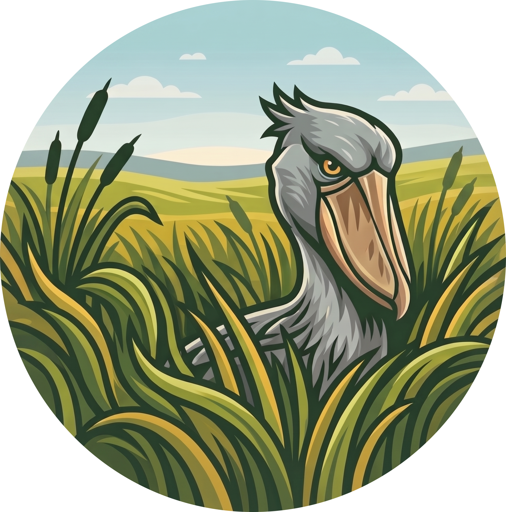

<p align="center">
  
</p>

<h1 align="center">Overgrass — your local Overleaf</h1>

A self-hosted, local clone of [Overleaf](https://www.overleaf.com): import the
projects you download from Overleaf and edit them on your own machine, with AI assistant that you can customize.


## Features

- **Import `.zip` project from Overleaf**
- **Overleaf-style 3-pane workspace** — file tree • CodeMirror 6 editor (LaTeX
  syntax highlighting, search, fold, line wrap) • PDF.js preview.
- **Auto-save** (2 mins one save)
- **SyncTeX two-way sync** (just like Overleaf's click-to-jump):
  - **Source → PDF**: double-click a line in the editor; the PDF scrolls to and
    flashes the matching spot.
  - **PDF → source**: double-click anywhere in the PDF; the matching source file
    opens and the editor jumps to that line.
- **Claude AI assistant**: (currently wired two functions)
  - Select text in the editor and **Ctrl/Cmd + right-click**
  to open a floating assistant: your selection is pre-loaded, you add an
  instruction (rewrite, fix, translate, explain…), and you choose whether to
  **replace the selection** with Claude's suggestion. Click outside to dismiss.
  - Diagnose the error message during latex compilation.
- **Version history & rollback**

## Quick start with Docker (recommended)

The Docker image bundles **Node + a full TeX distribution**, so you don't need
to install anything on your host except Docker — LaTeX compiles inside the
container.

```bash
cd overgrass/
# build the image and start the container
DATA_DIR=~/overgrass-projects scripts/docker.sh up
```

On its first run, the script installs an `overgrass` shell function into
`~/.bashrc`, so afterwards you can manage the container **from any directory**:

```bash
source ~/.bashrc                       # once (new terminals get it automatically)
DATA_DIR=~/overgrass-projects overgrass up
overgrass logs
overgrass restart      # restart the existing container (no rebuild, offline-safe)
overgrass recreate     # rebuild the image + recreate the container (after code changes)
overgrass down
```

(Set `OVERGRASS_NO_ALIAS=1` to skip the `~/.bashrc` install.)

Then open <http://localhost:3001>.

Your `.tex` sources live in `~/overgrass-projects/projects/<id>/`,
easy to back up or open with other tools.

```bash
scripts/docker.sh logs      # follow logs
scripts/docker.sh down      # stop & remove the container
scripts/docker.sh restart   # restart the existing container (no rebuild)
scripts/docker.sh recreate  # rebuild the image + recreate (after code changes)
```

Or with Docker Compose:

```bash
docker compose up -d --build
```

> **First build is slow & large.** `texlive-full` downloads several GB. For a
> much smaller image, override the TeX package set:
>
> ```bash
> TEX_PACKAGES="texlive-latex-extra texlive-bibtex-extra texlive-fonts-recommended biber latexmk" \
>   scripts/docker.sh up
> ```
>
> (or set the same `TEX_PACKAGES` build arg in `docker-compose.yml`).

Configuration env vars for the script: `PORT` (host port, default 3001),
`IMAGE`, `CONTAINER`, `DATA_VOLUME`, `TEX_PACKAGES`.

## Local development (without Docker)

```bash
# from the repo root
npm install        # installs both workspaces (client + server)
npm run dev        # starts the API (:3001) and the Vite dev server (:5173)
```

Open <http://localhost:5173>. This needs a host TeX install for compilation —
see [Prerequisites](#prerequisites).

### Production build (single port, no Docker)

```bash
npm run build      # builds server -> server/dist and client -> client/dist
npm start          # Express serves the API *and* the built client on :3001
```

When `client/dist` exists, the server serves it on the same origin (single
port). Override its location with the `CLIENT_DIST` env var.

## How it works

```
client (React + Vite, :5173)
  └─ /api/* ──proxy──▶ server (Express, :3001)
                         ├─ projects stored on disk under  ./<DATA_DIR>/projects/<id>/
                         ├─ metadata in  .overgrass.json
                         ├─ build output in  .build/  (hidden from the file tree)
                         └─ compile: latexmk -pdf -interaction=nonstopmode <main>.tex
```
- The **main file** is auto-detected (`main.tex`, else the first file containing
  `\documentclass`) and can be overridden with the ★ button in the file tree.

## Project layout

```
overgrass/
├── package.json          # npm workspaces + dev/build/docker scripts
├── Dockerfile            # multi-stage: build app, then Node + TeX Live runtime
├── docker-compose.yml    # one-command run with a persistent data volume
├── scripts/docker.sh     # build/up/down/logs helper
├── scripts/check-tex.mjs # TeX toolchain check
├── server/               # Express + TypeScript API
│   └── src/
│       ├── index.ts      # routes
│       ├── store.ts      # on-disk project storage, zip import/export
│       └── compile.ts    # latexmk compilation
└── client/               # React + TypeScript (Vite)
    └── src/
        ├── pages/        # Dashboard, Workspace
        ├── components/   # FileTree, CodeEditor, PdfViewer
        └── api.ts        # typed API client
```

## Notes & limitations

- Compilation runs your local `latexmk`; first compile of a document may pull in
  packages depending on your TeX install.
- No multi-user / real-time collaboration — this is a single-user local tool.
- SyncTeX needs the `synctex` binary (bundled with TeX Live) and a successful
  compile first; precision depends on your TeX version's SyncTeX data.

## License

Copyright (C) 2026 Runqiu Bao

Overgrass is free software: you can redistribute it and/or modify it under the
terms of the **GNU General Public License v3.0 or later** as published by the
Free Software Foundation. See [LICENSE](LICENSE) for the full text.

This program is distributed in the hope that it will be useful, but WITHOUT ANY
WARRANTY; without even the implied warranty of MERCHANTABILITY or FITNESS FOR A
PARTICULAR PURPOSE. See the GNU General Public License for more details.
